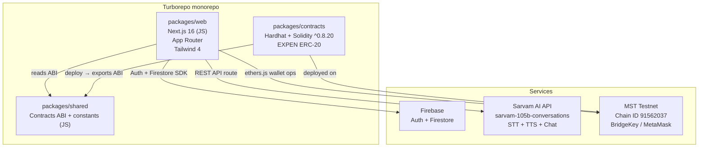

# harness.md — Expendry

> Source: `docs/raw.md` + interview (`docs/memory/interview.md`) + repo inspection.
> Status: **DRAFT — awaiting user approval** (Mode B gate).
> Commit plan: 130 commits planned across Sprint 0–Final (`docs/commit-plan.md`).

---

## 1. Problem Statement

See `docs/raw.md` for the full brief. Summary:

**Hackathon Problem 2 (Manufacturing):** When experienced operators retire, decades of
setup tricks, machine intuition, and troubleshooting knowledge walk out the door. New
operators take months to catch up; factories pay in scrap, downtime, and re-training costs.

**Expendry's answer:** A community-driven marketplace ecosystem where *experience is an
asset that doesn't get discarded* — veterans share knowledge, earn EXPEN tokens, and the
know-how is permanently discoverable by new operators.

---

## 2. Goals & Non-Goals

### Goals
- Deliver a working hackathon prototype (≤ 48-hour build window) that demonstrates all
  three judging-critical flows end-to-end.
- Tokenize experience: veteran posts → on-chain EXPEN mint → visible wallet balance.
- RAG-powered AI Agent over community content, voice-capable, multilingual (EN/HI/MR).
- Marketplace: browse machined-parts products; mock purchase.
- 3D Showcase: interactive model viewer for two featured products.
- Dark, minimal-yet-detailed design; Poppins + Montserrat; no AI-slop aesthetics.

### Non-Goals (hackathon scope)
- Real payment gateway (Stripe / Razorpay). Cart is UI-only.
- Real product catalog — seed with mock data.
- Real 3D models — use placeholder GLB files.
- Ratings / reviews on products.
- Mainnet deployment (testnet only).
- Full EXPEN spend mechanism in marketplace.
- Step-by-step operator guidance (hackathon lane 3 — deferred).

---

## 3. Users & Use Cases

| User | Role | Key action |
|---|---|---|
| **Veteran operator** | Contributor | Connect BridgeKey wallet → onboard → publish post (text / video-note / blueprint / setup-tip) → receive EXPEN |
| **New operator** | Learner | Browse community feed (no wallet) → search knowledge → ask AI Agent |
| **Factory buyer** | Buyer | Browse marketplace → view product detail → mock-buy |
| **Demo judge** | Evaluator | See all three flows live; verify token reward on MST testnet explorer |

---

## 4. Requirements

| ID | Statement | Priority | Source |
|---|---|---|---|
| REQ-001 | App is a Turborepo monorepo: `packages/web` (Next.js 16 JS), `packages/contracts` (Hardhat Solidity) | MUST | interview |
| REQ-002 | Navbar: Home · Marketplace · Community · 3D Showcase · Agent (5 pages, no About in nav) | MUST | interview |
| REQ-003 | Onboarding flow: wallet connect (BridgeKey / MetaMask) → Firebase Auth (wallet-mapped) → Discord-style animated profile setup (username, email, phone, designation, company) | MUST | interview |
| REQ-004 | Community feed: public read (no wallet), paginated LinkedIn-style posts | MUST | raw.md |
| REQ-005 | Post creation: wallet-connected users publish (text, setup tip, blueprint, idea, video-note) | MUST | raw.md |
| REQ-006 | EXPEN reward: 10 EXPEN minted on-chain per post, 50 EXPEN/day/wallet cap; operator backend calls mint | MUST | interview |
| REQ-007 | ERC-20 EXPEN token contract deployed to MST testnet by operator wallet | MUST | interview |
| REQ-008 | Wallet balance displayed in Community header (live query from MST testnet) | MUST | raw.md |
| REQ-009 | AI Agent page: chat + voice (Sarvam AI `sarvam-105b-conversations`), EN/HI/MR, RAG over Firestore community posts | MUST | interview |
| REQ-010 | Marketplace: browse products grid, product detail page, mock Buy button | MUST | raw.md |
| REQ-011 | 3D Showcase: interactive viewer (React Three Fiber + drei), two products, rotate/zoom/inspect | MUST | raw.md |
| REQ-012 | Design system: dark (#0a0a0a base), green (#22c55e accent), white text, ocean-blue secondary, grain/noise SVG overlay, Poppins + Montserrat | MUST | interview |
| REQ-013 | Home page: hero explaining the "experience walks out the door" problem, entry points to Marketplace / Community / 3D / Agent, About story inline | MUST | raw.md |
| REQ-014 | Accessibility: WCAG 2.1 AA contrast, focus states, keyboard nav, ARIA labels, reduced-motion support | MUST | raw.md |
| REQ-015 | Deploy to Vercel (monorepo, web package) | MUST | interview |
| REQ-016 | Seed marketplace with 8–12 mock machining/manufacturing products | SHOULD | interview |
| REQ-017 | Placeholder GLB files for 3D Showcase (CNC lathe + drill bit geometry) | SHOULD | interview |
| REQ-018 | Session log, EXPEN balance history in Firestore | SHOULD | raw.md |
| REQ-019 | Sarvam voice: speech-to-text (STT) input + text-to-speech (TTS) response | SHOULD | interview |
| REQ-020 | Post types: Experience story, Blueprint share, Idea, Setup tip / troubleshooting, Video / voice note | SHOULD | raw.md |

---

## 5. Acceptance Criteria

| ID | Given | When | Then | REQ |
|---|---|---|---|---|
| AC-003-a | User is on the app for the first time | User clicks "Connect Wallet" | BridgeKey/MetaMask prompt appears; on success, Discord-style onboarding animates (fade-up fields); profile saved to Firestore with wallet address mapped to Firebase UID | REQ-003 |
| AC-005-a | Veteran user is logged in with wallet connected | User submits a post (any type) | Post appears in feed within 2 s; a Next.js API route calls the operator backend to mint 10 EXPEN to the user's wallet; `POST /api/reward` returns `{txHash}` | REQ-005, REQ-006 |
| AC-006-a | User has posted 5 times today (50 EXPEN earned) | User tries to post a 6th time | UI shows "Daily limit reached (50 EXPEN/day)"; no mint is attempted | REQ-006 |
| AC-007-a | Operator runs `deploy:testnet` script | Hardhat compiles EXPEN.sol and deploys to MST testnet | Contract address logged; ABI exported to `packages/shared/src/contracts.js`; testnet explorer shows contract verified | REQ-007 |
| AC-008-a | Community page loads | Any user (wallet or not) opens Community | Feed renders public posts; wallet-connected users see live EXPEN balance in the header | REQ-004, REQ-008 |
| AC-009-a | User is on Agent page | User types or speaks a question about platform or machining | Agent responds in the chosen language (EN/HI/MR) within 4 s using RAG over Firestore posts via Sarvam AI | REQ-009 |
| AC-010-a | User opens Marketplace | — | Product grid shows ≥ 8 products with image, name, price; clicking a product opens detail page; "Buy" button shows a mock confirmation toast | REQ-010, REQ-016 |
| AC-011-a | User opens 3D Showcase | — | Two 3D models load (< 3 s on 50 Mbps); user can rotate/zoom with mouse/touch; "View in Marketplace" link works | REQ-011, REQ-017 |
| AC-012-a | Any page | — | All text passes WCAG 2.1 AA contrast check; tab order is logical; no colour as sole information carrier | REQ-012, REQ-014 |
| AC-013-a | Home page | — | Hero section explains the problem; at minimum 3 entry-point CTAs (Marketplace, Community, Agent) are visible above the fold on 1440px | REQ-013 |

---

## 6. Architecture & Tech Stack

### Project type: `fullstack-web` + `blockchain` (custom monorepo)



### Tech decisions

| Layer | Choice | Reason |
|---|---|---|
| Monorepo | Turborepo (bun workspaces) | User-specified; matches MST Vibe Kit pattern |
| Next.js | 16.4.1, App Router, **JavaScript only** | User-mandated; no TS, no React Compiler, Cache Components ON |
| Styling | Tailwind CSS 4 | Already installed |
| UI components | shadcn/ui + Aceternity UI | User-chosen |
| Animation | Framer Motion | User-chosen |
| 3D | React Three Fiber + @react-three/drei | User-chosen |
| Auth + DB | Firebase (Firestore + Auth, free tier) | User-chosen; wallet address → Firebase UID |
| AI agent | Sarvam AI (`sarvam-105b-conversations`) | Pre-configured in `.env` |
| Blockchain | MST testnet (EVM), ethers.js v6 | From `docs/MST_FACTS.md` |
| Wallet | BridgeKey (EIP-1193) + MetaMask fallback | From `docs/MST_FACTS.md` |
| Smart contracts | Hardhat + Solidity ^0.8.20 + OpenZeppelin v5 | From `docs/MST_FACTS.md` |
| Package manager | bun | Already in `package.json` |
| Deploy | Vercel (monorepo, web package root) | User-chosen |

### ADRs
- `docs/adr/ADR-0001-monorepo-structure.md` (to be written in Sprint 0)
- `docs/adr/ADR-0002-firebase-auth-wallet-mapping.md`
- `docs/adr/ADR-0003-offchain-posts-onchain-rewards.md`

---

## 7. Project Structure

```
expendry/                         ← repo root
├── AGENTS.md
├── docs/
│   ├── raw.md  harness.md  prompt.md
│   ├── Mcp.md  McpCheck.md  Mcpguide.md
│   ├── MST_FACTS.md  JAVASCRIPTMSTSDK.MD  RESOURCES.MD  SOLIDITY.MD
│   ├── memory/  interview.md  assumptions.md  lessons.md  glossary.md
│   └── adr/
├── harness/                      ← harness machinery (not product code)
│   ├── agents/  roles/  workflows/  standards/  tools/  state/  artifacts/  tasks/  logs/
├── scripts/  tests/harness/
├── packages/
│   ├── web/                      ← Next.js 16 App Router (JS)
│   │   ├── src/app/
│   │   │   ├── (marketing)/      ← Home page route group
│   │   │   ├── marketplace/
│   │   │   ├── community/
│   │   │   ├── showcase/         ← 3D Showcase
│   │   │   ├── agent/            ← AI Agent page
│   │   │   ├── onboarding/
│   │   │   ├── api/              ← API routes (reward, agent, posts)
│   │   │   ├── layout.js  globals.css
│   │   ├── src/components/       ← shared UI components
│   │   │   ├── ui/               ← shadcn/ui primitives
│   │   │   ├── layout/           ← Navbar, Footer, FloatingAgent
│   │   │   ├── community/        ← Feed, PostCard, PostComposer
│   │   │   ├── marketplace/      ← ProductGrid, ProductCard, ProductDetail
│   │   │   ├── showcase/         ← ModelViewer, ProductScene
│   │   │   ├── agent/            ← ChatInterface, VoiceButton, MessageBubble
│   │   │   └── onboarding/       ← WalletConnect, ProfileSetup steps
│   │   ├── src/lib/
│   │   │   ├── firebase.js       ← Firebase client init
│   │   │   ├── sarvam.js         ← Sarvam AI client
│   │   │   ├── wallet.js         ← BridgeKey/MetaMask connect helpers
│   │   │   ├── expen.js          ← EXPEN contract interaction (ethers.js)
│   │   │   └── rag.js            ← RAG: Firestore posts → context chunks
│   │   ├── src/hooks/            ← useWallet, useExpenBalance, useCommunityFeed
│   │   ├── src/data/             ← products.js (mock), models.js (3D refs)
│   │   └── package.json  next.config.mjs  tailwind.config.js
│   ├── contracts/
│   │   ├── contracts/EXPEN.sol
│   │   ├── scripts/deploy.js
│   │   ├── test/EXPEN.test.js
│   │   └── hardhat.config.js
│   └── shared/
│       ├── src/contracts.js      ← ABI + deployed addresses
│       └── src/constants.js      ← Chain ID, RPC, token decimals
├── turbo.json
├── bun.lock
└── package.json                  ← workspace root
```

Module ownership (for lane decomposition):
- **Lane A (Foundation):** `packages/web/src/app/layout.js`, Navbar, design system, globals
- **Lane B (Community):** `packages/web/src/app/community/`, community components, `api/posts/`, `api/reward/`
- **Lane C (Agent):** `packages/web/src/app/agent/`, agent components, `api/agent/`, RAG lib
- **Lane D (Marketplace + 3D):** `packages/web/src/app/marketplace/`, `packages/web/src/app/showcase/`
- **Lane E (Contracts):** `packages/contracts/`, `packages/shared/src/contracts.js`
- **Lane F (Onboarding + Auth):** `packages/web/src/app/onboarding/`, Firebase auth, wallet hooks

---

## 8. Commands

> These are the ONLY commands agents may run. Derived from the tech stack.

| Purpose | Command |
|---|---|
| **install** | `bun install` (run from repo root) |
| **dev (web)** | `bun run dev --filter=web` |
| **dev (contracts — Hardhat node)** | `bun run dev --filter=contracts` |
| **lint** | `bun run lint --filter=web` (Next.js ESLint) |
| **format** | `npx prettier --write "packages/**/*.{js,jsx,css,json}"` |
| **typecheck** | _(n/a — JS only; eslint covers basic errors)_ |
| **unit test (contracts)** | `bun run test --filter=contracts` (Hardhat / Mocha) |
| **unit test (web)** | _(Jest or Vitest — to be added in Sprint 0)_ |
| **build** | `bun run build --filter=web` |
| **compile contracts** | `bun run compile --filter=contracts` |
| **deploy contracts (testnet)** | `bun run deploy:testnet --filter=contracts` |
| **harness self-test** | `python scripts/check_harness.py && pytest tests/harness` |

---

## 9. Coding & Testing Standards

See `harness/standards/coding.md` and `harness/standards/testing.md` (generated in Sprint 0).

### Summary
- **Language:** JavaScript (ESNext, no TypeScript). JSDoc comments for public functions.
- **React:** Functional components only. Hooks over HOCs. No class components.
- **Next.js:** App Router. Server Components where possible; `'use client'` only when needed (interactivity, browser APIs, wallet).
- **Cache Components:** Use `use cache` directive per Next.js 16 caching model. Read `node_modules/next/dist/docs/` before writing caching code.
- **Naming:** `camelCase` for variables/functions, `PascalCase` for components, `kebab-case` for files.
- **Styling:** Tailwind utility classes. No inline styles. Design tokens via CSS variables in `globals.css`.
- **Imports:** No `@/` alias (per `raw.md`). Relative imports within a package.
- **Secrets:** No secrets in source. Env vars via `.env` (gitignored). Never log `OPERATOR_PRIVATE_KEY` or `SARVAM_API_KEY`.
- **Tests:** Contract tests in `packages/contracts/test/` (Hardhat/Mocha). Web unit tests target critical utility functions (wallet helpers, RAG chunking, reward cap logic). Coverage floor: 70% on changed lines.
- **Accessibility:** Every interactive element gets `aria-label` or visible text. Colour contrast ≥ 4.5:1 AA. No `outline: none` without replacement.
- **No AI slop design:** No generic gradient blobs, no overused glassmorphism without purpose. Every visual effect has a design reason.

---

## 10. Tools, APIs & MCP Servers

See `harness/tools/registry.yaml` (generated Sprint 0) and `docs/Mcp.md`.

Active preset for this project: **`fullstack-web`** plus MST-specific additions.

| Tool / Service | Purpose | Auth |
|---|---|---|
| Firebase Firestore | Posts, user profiles, sessions | `FIREBASE_*` env vars |
| Firebase Auth | Wallet-address-mapped user accounts | Same |
| Sarvam AI API | LLM chat + STT + TTS | `SARVAM_API_KEY` |
| MST Testnet RPC | Blockchain reads/writes | `OPERATOR_PRIVATE_KEY` (server-only) |
| BridgeKey / MetaMask | Frontend wallet connection (EIP-1193) | User's wallet |
| Hardhat | Contract compile, test, deploy | `OPERATOR_PRIVATE_KEY` |
| MCP: context7 | Live Next.js / ethers / Firebase docs | optional key |
| MCP: playwright | E2E tests | — |
| MCP: shadcn | Component registry | — |
| MCP: magicui | Motion primitives | — |
| MCP: next-devtools | Route/compile diagnostics | — |
| MCP: sequential-thinking | Complex reasoning scratchpad | — |

---

## 11. Autonomy & Approval Matrix

| Action | Approval | Notes |
|---|---|---|
| Read any file | Auto | All roles |
| Write product source files (in lane) | Auto | Builder only, path-guarded |
| `bun install` (add new package) | **Confirm** | Must be approved in harness task |
| Deploy contracts to MST testnet | **Confirm** | Orchestrator notifies user before running |
| Deploy contracts to MST mainnet | **Forbidden** | Never in this build |
| `git push` | **Confirm** | User pushes or approves |
| Delete any file | **Confirm** | Except `tmp/` |
| Modify `.env` | **Forbidden** | User manages secrets |
| Call Sarvam AI API (in agents) | Auto | Rate-limited by budget |
| Firebase writes from agents | **Confirm** | Only seeding / schema migration |

---

## 12. Sprint Plan

### Sprint 0 — Harness Scaffold & Monorepo Bootstrap
**Goal:** Harness passes G0; monorepo scaffold compiles and runs `bun run dev --filter=web`.

| Task | Owner | Lane |
|---|---|---|
| T-S0-01: Write `scripts/check_harness.py` + `tests/harness/` (red first) | Builder | E |
| T-S0-02: Bootstrap Turborepo monorepo structure (`packages/web`, `contracts`, `shared`) | Builder | A |
| T-S0-03: Configure Next.js 16 in `packages/web` (migrate from current `src/`) | Builder | A |
| T-S0-04: Write harness agents, roles, standards, registry files | Builder | E |
| T-S0-05: Deploy EXPEN.sol to MST testnet; export ABI to `packages/shared` | Builder | E |
| T-S0-06: Configure Firebase (client + admin SDK); write `packages/web/src/lib/firebase.js` | Builder | F |

Exit gate: `python scripts/check_harness.py` ✅ `pytest tests/harness` ✅ `bun run build --filter=web` ✅

---

### Sprint 1 — Walking Skeleton (Core Demo Loop)
**Goal:** Veteran posts → EXPEN minted → visible in wallet. Demo-ready for judges.

| Task | Lane | AC refs |
|---|---|---|
| T-001: Design system (globals, Tailwind tokens, Poppins+Montserrat, grain overlay) | A | AC-012-a |
| T-002: Navbar + page shell (5 routes, active state, mobile responsive) | A | REQ-002 |
| T-003: Onboarding flow (wallet connect → Firebase Auth → Discord-style profile) | F | AC-003-a |
| T-004: Community feed (public read, post cards, pagination) | B | AC-008-a |
| T-005: Post composer (types, submit, on-chain reward call) | B | AC-005-a, AC-006-a |
| T-006: Home page (hero, CTAs, About story inline) | A | AC-013-a |

Exit gate: All G1–G4 green; demo loop live on Vercel preview URL.

---

### Sprint 2 — Agent + Marketplace + 3D
**Goal:** All three hackathon flows working.

| Task | Lane | AC refs |
|---|---|---|
| T-007: AI Agent page (Sarvam chat + voice + multilingual) | C | AC-009-a |
| T-008: RAG pipeline (Firestore posts → chunked context → Sarvam query) | C | AC-009-a |
| T-009: Marketplace (product grid + detail + mock Buy) | D | AC-010-a |
| T-010: 3D Showcase (R3F + drei viewer, two placeholder models) | D | AC-011-a |

Exit gate: Full demo rehearsal passes; accessibility audit passes; Vercel deploy green.

---

### Sprint Final — Polish & Demo Prep
**Goal:** Presentation-ready. Every judge criterion covered.

| Task | Notes |
|---|---|
| T-011: Accessibility audit (contrast, ARIA, keyboard nav) | WCAG 2.1 AA |
| T-012: Performance pass (LCP < 2.5 s, no layout shift) | chrome-devtools MCP |
| T-013: Demo script + user-research quotes in About section | 25 pts judging |
| T-014: README + CHANGELOG | Scribe |

---

## 13. Risks & Mitigations

| Risk | Likelihood | Impact | Mitigation |
|---|---|---|---|
| MST testnet RPC instability | Medium | High | Cache last-known balance; show "testnet may be slow" banner |
| Sarvam API rate limit during demo | Low | High | Cache RAG responses; fallback to canned answers |
| BridgeKey wallet not installed by judge | Medium | Medium | MetaMask fallback; "install BridgeKey" link + QR code |
| 3D model loading slow on demo network | Medium | Medium | `<Suspense>` fallback; aggressive LOD; pre-bake geometry |
| React Three Fiber + Next.js 16 SSR conflict | Medium | High | Force 3D components to `'use client'`; dynamic import with `ssr: false` |
| Firebase free tier quotas hit during demo | Low | Medium | Firestore rules limit reads; cache feed in SWR |
| Framer Motion + React 19 compatibility | Low | Medium | Pin to a tested version before Sprint 1 |

---

## 14. Assumptions

| ID | Statement | Date | Status |
|---|---|---|---|
| A-001 | The "About" page content is folded into the Home hero; no separate About route | 2026-10-27 | Active |
| A-002 | Marketplace products will be seeded as mock data (machining/CNC tools); team supplies real data post-hackathon | 2026-10-27 | Active |
| A-003 | 3D models are placeholder GLB files; team replaces with real assets post-hackathon | 2026-10-27 | Active |
| A-004 | EXPEN reward minting is done server-side (API route) using `OPERATOR_PRIVATE_KEY`; no client-side key exposure | 2026-10-27 | Active |
| A-005 | Daily reward cap (50 EXPEN/day/wallet) is enforced in Firestore (read daily tally before minting); on-chain mint is the source of truth for balance | 2026-10-27 | Active |
| A-006 | Sarvam AI's `sarvam-105b-conversations` supports all three languages (EN/HI/MR) natively | 2026-10-27 | **Needs verification** |
| A-007 | MST testnet is EVM-compatible; ethers.js v6 works without modification | 2026-10-27 | Active (confirmed by MST_FACTS.md) |
| A-008 | Monorepo will be a fresh Turborepo workspace wrapping the existing `src/` app into `packages/web/` | 2026-10-27 | Active |
| A-009 | No real user interviews have been conducted yet; the Home page will include a "user insight" section using operator persona quotes (clearly labelled as illustrative) | 2026-10-27 | Active |

---

## 15. Open Questions

<!-- All 5 questions resolved prior to Sprint 1 start:
1. Sarvam STT/TTS endpoints: Standard Sarvam API.
2. Firebase Storage: Skip media attachments; use text/mock in prototype.
3. EXPEN contract ABI: Implemented in packages/contracts and exported to packages/shared.
4. Vercel monorepo root: Root directory with Turborepo workspace.
5. Authorized wallets: Operator/admin wallet configured in .env.
-->

## 16. Definition of Done

A task is **Done** when:
- [ ] Artifacts `01-spec.md` … `08-docs.md` exist for the task and every handoff validated
- [ ] G0–G4 pass with logged evidence (`events.jsonl`)
- [ ] Every `AC-*` in the task has ≥ 1 passing test or recorded manual evidence
- [ ] No new ESLint warnings; no skipped tests added; coverage ≥ 70 % on changed lines
- [ ] Reviewer: 0 BLOCKER/MAJOR · Security: 0 high/critical · Docs updated
- [ ] Guard clean; no breaker tripped; `state.json` updated
- [ ] AGENTS.md still accurate (Librarian verified)
- [ ] `OPERATOR_PRIVATE_KEY`, `SARVAM_API_KEY`, and Firebase keys are NOT in any committed file
- [ ] Design: no contrast failures (checked via Playwright a11y snapshot)

---

## 18. Commit Plan

Full 130-commit plan: [`docs/commit-plan.md`](commit-plan.md)
Git standards (convention, branching, merge requirements): [`harness/standards/git.md`](../harness/standards/git.md)

### Type distribution

| Type | Count | Examples |
|---|---|---|
| `feat` | 49 | All product features — posts, reward, agent, marketplace, 3D |
| `chore` | 23 | Harness scripts, state updates, sprint gates, monorepo config |
| `test` | 16 | Written **before** the code they verify (TDD red-first) |
| `build` | 7 | Turborepo, package.json, Hardhat, turbo pipeline |
| `docs` | 9 | ADRs, README, CHANGELOG, lessons, AGENTS.md |
| `security` | 6 | Rate-limit, CSP, semgrep, contract verification, DOMPurify |
| `a11y` | 6 | Contrast, focus-trap, live-regions, keyboard 3D controls |
| `perf` | 5 | PPR, image optimisation, lazy-load, feed caching |
| `style` | 4 | Design tokens, Tailwind config, grain overlay |
| **Total** | **130** | |

### Non-negotiable commit rules (enforced by Reviewer gate)
1. Subject ≤72 chars, imperative mood, scope mandatory.
2. No UI-only commits — every visual change links to a measurable behaviour.
3. Tests committed with or before the code they test.
4. `python scripts/check_harness.py` must pass before every push.
5. Forbidden subjects: "update", "wip", "fix stuff", "misc", "tweaks", "minor changes".

---

## 17. Glossary

| Term | Meaning |
|---|---|
| EXPEN | The ERC-20 experience token minted on MST testnet when veterans post |
| MST testnet | MST Blockchain testnet, Chain ID `91562037`, RPC `https://testnetrpc.mstblockchain.com` |
| BridgeKey | Official MST wallet (Chrome extension); EIP-1193 compatible |
| RAG | Retrieval-Augmented Generation — fetching relevant Firestore posts as context before querying Sarvam AI |
| Operator wallet | The `OPERATOR_PRIVATE_KEY` holder — mints EXPEN on behalf of the platform |
| Sarvam AI | Indian multilingual AI provider; model `sarvam-105b-conversations` |
| Aceternity UI | Open-source component library for hero/card/spotlight effects |
| R3F | React Three Fiber — React renderer for Three.js |
| Lane | A Builder's isolated git branch owning a disjoint set of files (prevents merge conflicts) |
